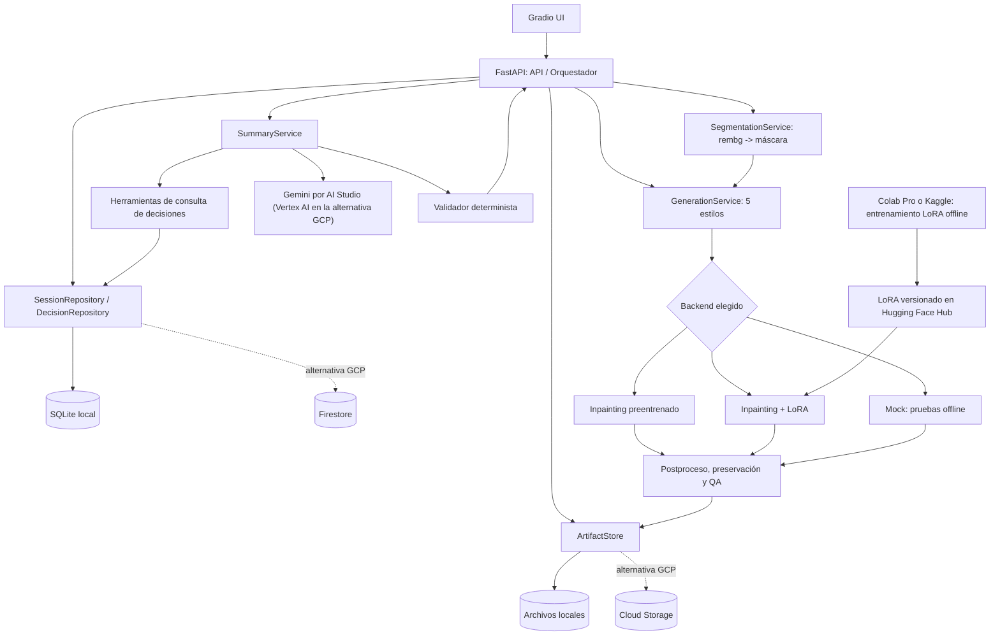
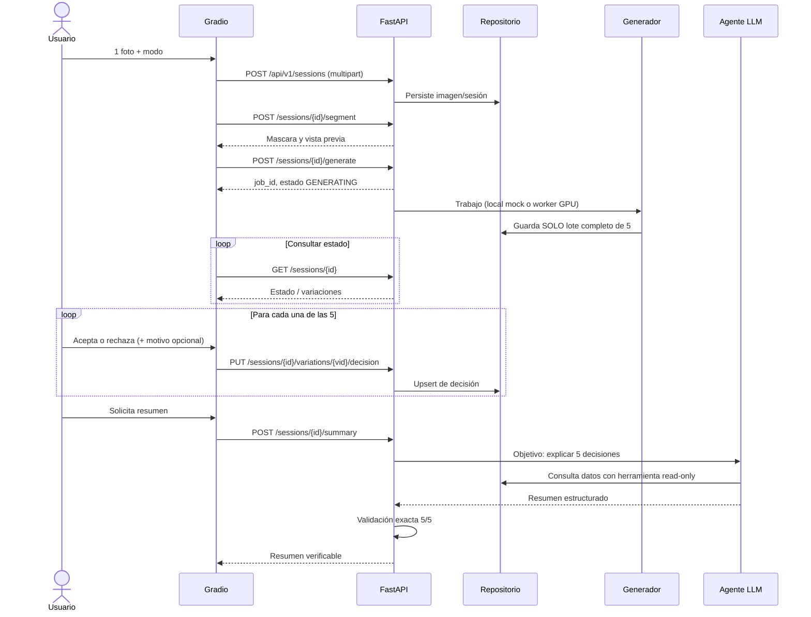
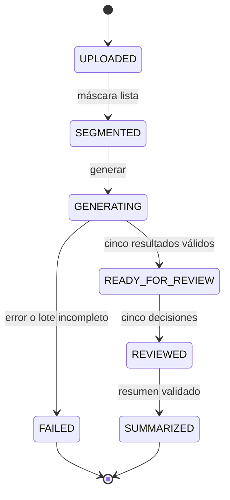
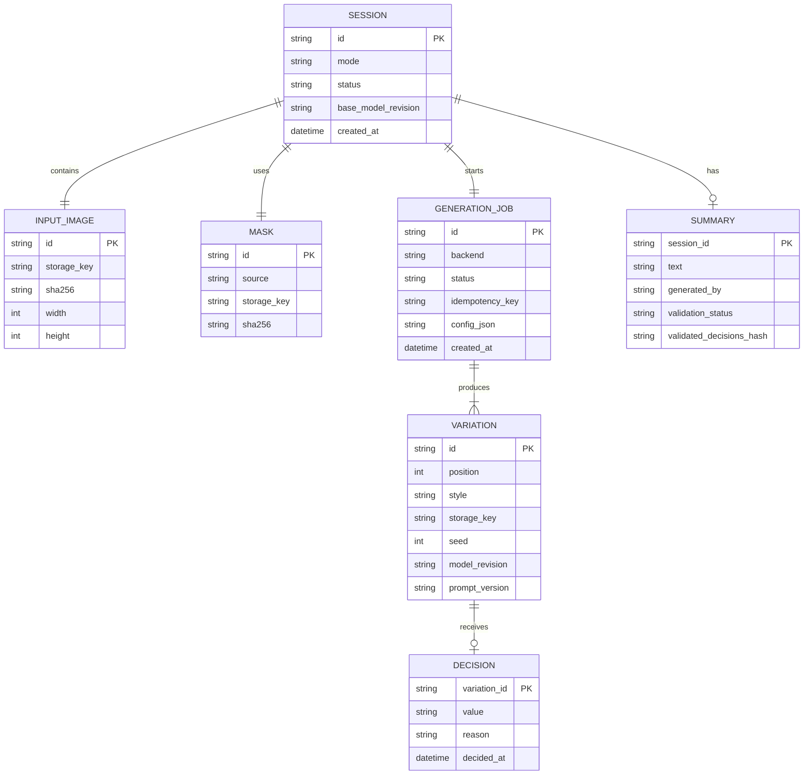
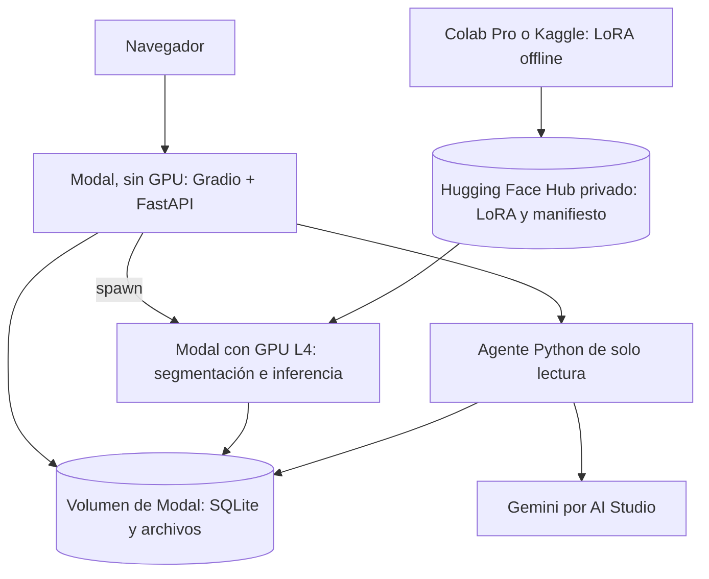
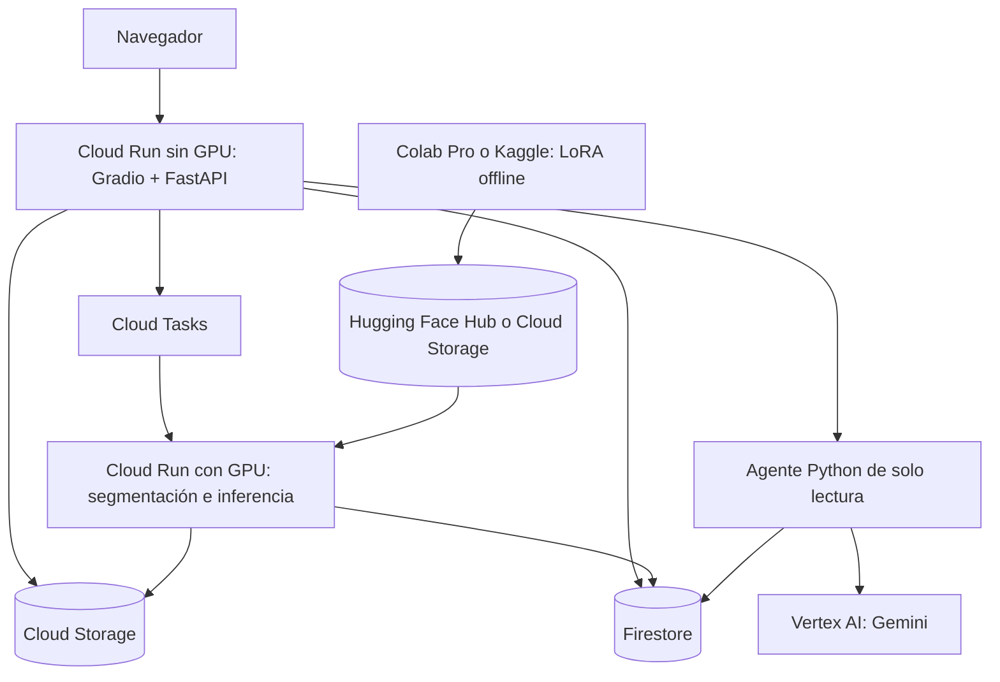

# 01 — Arquitectura y diagramas

Las versiones editables en draw.io y exportadas en PNG están en [`diagrams/`](diagrams/README.md).

## Criterios de diseño

Separar dominio/servicios de implementaciones de infraestructura. El mismo orquestador invoca backends intercambiables: `mock`, `pretrained_inpainting`, `lora_inpainting`. **`mock` es solo para desarrollo y pruebas y no cuenta como enfoque académico.** El procesamiento de GPU debe ser independiente de la API/web. En la laptop y en Modal se usa SQLite + carpetas (en Modal, sobre un volumen); en la alternativa GCP, Firestore + Cloud Storage mediante adaptadores (ADR-009, sección F).

## A. Componentes



**Nota:** los componentes de nube son adaptadores futuros; el código actual no se conecta a servicios cloud ni usa pesos de GPU. El mapeo por entorno (Modal, GCP y laptop) está en la sección F.

## B. Flujo de sesión (v1)



### Regla de consistencia

Un lote **solo** está `READY_FOR_REVIEW` si existen exactamente cinco variaciones verificadas y archivos disponibles. Si falla a mitad de la inferencia, marcar `FAILED`, limpiar artefactos transitorios y NO mostrar tres o cuatro resultados como éxito. Concurrencia/idempotencia: un `session_id` solo admite un lote iniciado; un reintento con la misma llave no debe duplicarlo.

## C. Estados de dominio



**Nota:** cambiar una decisión después del resumen debe invalidarlo y obligar a recomputarlo, o congelar las decisiones cuando la sesión termine; en v1 se **congelan después de SUMMARIZED**. Hasta entonces se permite corregir aceptación/rechazo.

## D. Entidades y relaciones



## E. Interfaces portables

```python
class SegmentationService(Protocol):
    def segment(self, image: ImageArtifact) -> MaskArtifact: ...

class GenerationBackend(Protocol):
    def generate(self, request: GenerationRequest) -> list[GeneratedArtifact]: ...

class ArtifactStore(Protocol):
    def save(self, data: bytes, key: str) -> str: ...

class DecisionRepository(Protocol):
    def list_for_session(self, session_id: str) -> list[Decision]: ...

class SummaryService(Protocol):
    def summarize(self, session_id: str) -> Summary: ...
```

*Especificaciones conceptuales*: La implementación deberá concretar los tipos en el repositorio. No copiar interfaces sin implementar semánticas de errores, configuración e idempotencia definidas en el contrato.

## F. Mapeo de arquitecturas: Modal, GCP y local

Modal es el despliegue principal (ADR-009, que reemplaza a ADR-003). GCP queda como alternativa compatible y la laptop como entorno de desarrollo. Las tres usan el mismo dominio, la misma API `/api/v1` y las mismas interfaces; solo cambian los adaptadores, como piezas de un rompecabezas.

| Pieza | A: Modal (principal) | B: GCP (alternativa) | C: laptop (desarrollo) | Interfaz común |
|---|---|---|---|---|
| Worker GPU: segmentación y generación en ambos modos, con el LoRA | Función de Modal con L4, escala a cero | Cloud Run con GPU L4 | uvicorn con la RTX 4060 de 8 GB | Contrato HTTP del worker |
| Cómo llega la API al worker | HTTP | HTTP | HTTP o en el mismo proceso | `GenerationBackend` (adaptador remoto) |
| UI y API | Endpoint web de Modal, sin GPU | Cloud Run sin GPU | uvicorn | Contrato `/api/v1` |
| Sesiones, decisiones y resúmenes | SQLite en un volumen de Modal (un solo contenedor de API) | Firestore | SQLite | `Repository` |
| Imágenes y máscaras | Volumen de Modal | Cloud Storage | `data/assets/` | `ArtifactStore` |
| Agente LLM | Gemini por AI Studio | Gemini en Vertex AI | Gemini por AI Studio u Ollama | `SummaryService` y validador determinista |
| Segundo LLM, para comparar | Modelo abierto gratuito en la nube | Modelo abierto en Vertex AI | Ollama | `SummaryService` |
| Ejecución de trabajos | `spawn` de Modal | Cloud Tasks | Hilo del mismo proceso | `JobRunner` y semántica `202` |
| Entrenamiento del LoRA | Colab Pro (Pedro); Kaggle de respaldo | Igual | Igual (8 GB no alcanzan para entrenar SDXL) | Adaptador exportado con manifiesto |
| Pesos del LoRA y dataset curado | Repositorios privados en Hugging Face Hub | Hub o Cloud Storage | Hub o copia local | `LORA_ADAPTER_URI` con revisión y checksum |
| Secretos | Secretos de Modal | Secret Manager | `.env` no versionado | Configuración por entorno |
| Registros | Logs de Modal | Cloud Logging | stdout | Mismos eventos `GUARDRAIL` |

El worker se escribe una vez y lo que cambia es dónde se aloja. El adaptador de Gemini llama a la API REST con `httpx`; pasar de AI Studio a Vertex AI cambia la URL y la autenticación, no el formato. Pasar de A a B exige los adaptadores de Firestore y Cloud Storage, un Dockerfile y la configuración de GCP, sin tocar dominio, UI ni pruebas.

**Estado de las piezas (2026-11-13).** Todas son interfaces con adaptadores: `Repository` (`storage/ports.py`, hoy SQLite), `ArtifactStore`, `GenerationBackend` (mock y `RemoteGenerationBackend`), `SegmentationService`, `SummaryService` (determinista y Gemini) y `JobRunner`. La raíz de composición (`backend/productshot/composition.py`) es el único lugar que conoce las clases concretas y elige cada adaptador con variables de entorno; una configuración incompleta falla al arrancar, y `GET /api/v1/healthz` informa qué adaptador quedó en cada pieza. `tests/test_ports.py` corre el flujo completo con el mock dentro del proceso y con el mock detrás del contrato HTTP del worker, y verifica que el orquestador y la API solo usen métodos de `Repository`. Falta el ejecutor de Modal (`spawn`), que llega con el despliegue (P10).

**Contrato del worker.** `GET /v1/health` devuelve `{contract_version, backend, model_revision, simulated}`; `POST /v1/generate` recibe la foto de trabajo y la máscara en PNG base64 más las cinco especificaciones (`position`, `style`, `seed`, `adjustments`) y devuelve las cinco imágenes con su revisión y parámetros. Con `GENERATION_WORKER_TOKEN`, ambas rutas exigen `Authorization: Bearer`. El worker no guarda estado: un reintento produce el mismo lote con las mismas semillas y la API confirma solo el primero. La API no confía en el worker: el lote de cinco, G8, G9 y G14 se validan igual que con el mock, y si el worker no responde se asume simulado. Detalle en `backend/productshot/worker/contract.py`.

La configuración de desarrollo (`GENERATION_BACKEND=mock`, `SUMMARY_BACKEND=deterministic`) no cuenta como enfoque académico ni el resumen determinista como agente.

### Modal (principal)



### GCP (alternativa)



Los diagramas `01-arquitectura-gcp` y `02-arquitectura-local` de `docs/diagrams/` muestran el diseño anterior a ADR-009: el 01 corresponde hoy a la alternativa B.

### Niveles de respaldo para la demo

1. **Modal:** el worker se calienta antes de presentar (un contenedor mínimo solo durante la demo, y se vuelve a 0 al terminar).
2. **Laptop:** la misma aplicación con el worker en la RTX 4060, si la medición confirma que alcanza.
3. **Video grabado y sesión ya generada:** sirven como evidencia si fallan los anteriores, pero no sustituyen la demostración en vivo.

### Diferencias que todos los adaptadores deben cubrir

- **Lote atómico:** una sesión solo pasa a `READY_FOR_REVIEW` con cinco artefactos y registros, sin depender de transacciones SQL.
- **Reintentos:** `spawn` de Modal y Cloud Tasks pueden repetir entregas, así que el worker debe ser idempotente; el ejecutor local cumple el mismo contrato.
- **Trabajos interrumpidos:** un reinicio del proceso o del worker no debe dejar la sesión en `GENERATING` indefinidamente (G14 ya la vence).
- **Almacenamiento:** Cloud Run y los contenedores de Modal tienen disco efímero; solo el volumen, Cloud Storage o `data/` persisten.
- **Un solo escritor de SQLite:** en Modal, la API corre en un solo contenedor (`max_containers=1`) mientras la base sea SQLite.

## G. Guardrails ante fallos

La lista completa de guardrails (G1 a G14), su estado por hito y las decisiones tomadas están en [`08_ITERACIONES_Y_GUARDRAILS.md`](08_ITERACIONES_Y_GUARDRAILS.md), parte B, registrada como ADR-008. Esta sección no la duplica.

Las garantías de arquitectura que los sostienen ya están descritas arriba: lote atómico de cinco, idempotencia, recuperación de trabajos interrumpidos, máscara bloqueada tras generar y agente con herramientas de solo lectura y salida verificada.
