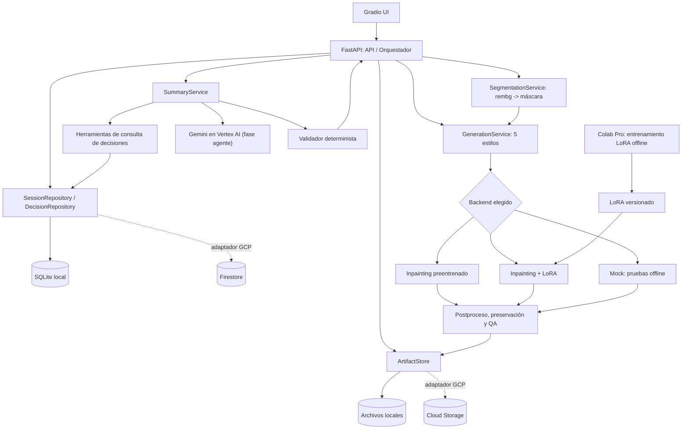
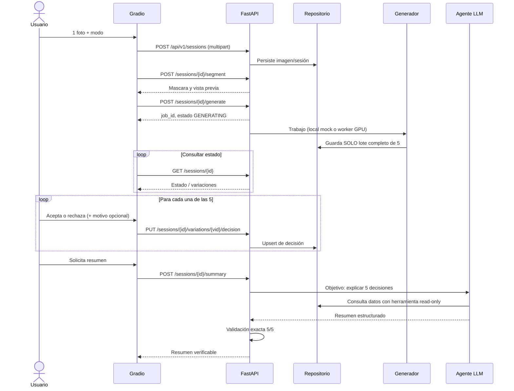
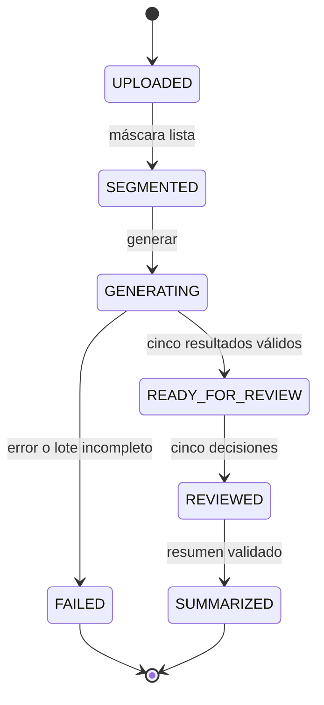
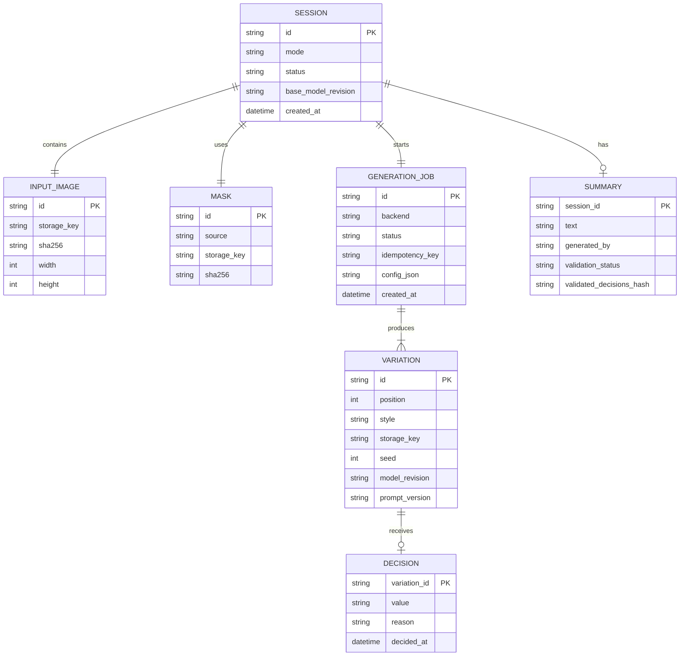
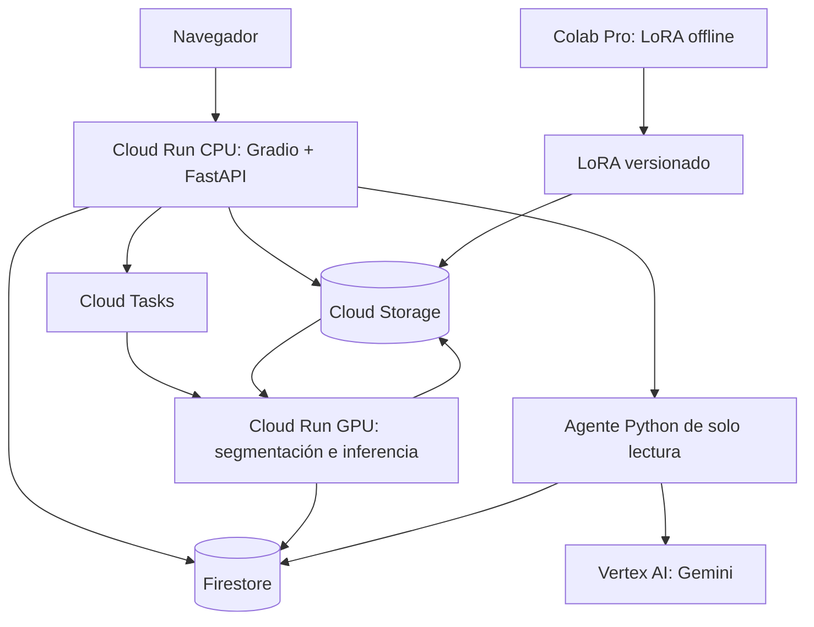
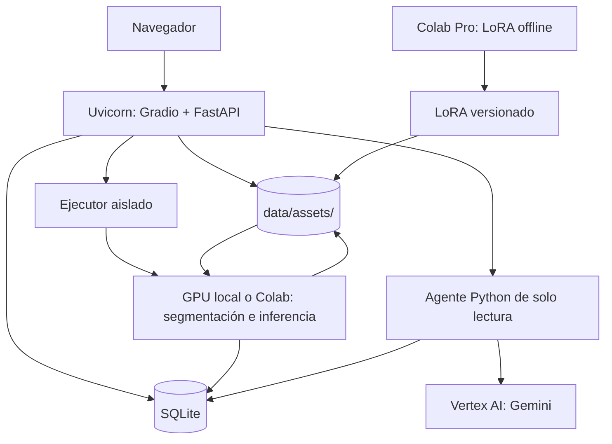

# 01 — Arquitectura y diagramas

Las versiones editables en draw.io y exportadas en PNG están en [`diagrams/`](diagrams/README.md).

## Criterios de diseño

Separar dominio/servicios de implementaciones de infraestructura. El mismo orquestador invoca backends intercambiables: `mock`, `pretrained_inpainting`, `lora_inpainting`. **`mock` es solo para desarrollo y pruebas y no cuenta como enfoque académico.** El procesamiento de GPU debe ser independiente de la API/web. En local usar persistencia SQLite + carpetas; en nube Firestore + Cloud Storage mediante adaptadores.

## A. Componentes — local y GCP



**Nota:** componentes GCP dibujados como adaptadores futuros; el primer PR NO establece conexiones reales con servicios cloud ni usa pesos GPU.

## B. Flujo de sesión (v1)



### Regla de consistencia

Un lote **solo** está `READY_FOR_REVIEW` si existen exactamente cinco variaciones verificadas y archivos disponibles. Si falla a mitad de la inferencia, marcar `FAILED`, limpiar artefactos transitorios y NO mostrar tres o cuatro resultados como éxito. Concurrencia/idempotencia: un `session_id` solo admite un lote iniciado; un reintento con la misma llave no debe duplicarlo.

## C. Estados de dominio



**Nota:** cambiar una decisión después del resumen debe invalidarlo y obligar a recomputarlo, o congelar las decisiones cuando la sesión termine; en v1 se **congelan después de SUMMARIZED**. Hasta entonces se permite corregir aceptación/rechazo.

## D. Entidades y relaciones



## E. Interfaces portables

```python
class SegmentationService(Protocol):
    def segment(self, image: ImageArtifact) -> MaskArtifact: ...

class GenerationBackend(Protocol):
    def generate(self, request: GenerationRequest) -> list[GeneratedArtifact]: ...

class ArtifactStore(Protocol):
    def save(self, data: bytes, key: str) -> str: ...

class DecisionRepository(Protocol):
    def list_for_session(self, session_id: str) -> list[Decision]: ...

class SummaryService(Protocol):
    def summarize(self, session_id: str) -> Summary: ...
```

*Especificaciones conceptuales*: La implementación deberá concretar los tipos en el repositorio. No copiar interfaces sin implementar semánticas de errores, configuración e idempotencia definidas en el contrato.

## F. Mapeo de arquitecturas: GCP y local

GCP es el despliegue principal y la arquitectura local es su respaldo (ver ADR-003). Ambas usan el mismo dominio, la misma API `/api/v1` y las interfaces de la sección E; cambian los adaptadores. Ninguna está implementada todavía.

| Componente | GCP (principal) | Local (respaldo) | Interfaz común |
|---|---|---|---|
| UI y API | Cloud Run CPU: Gradio + FastAPI | Uvicorn: Gradio + FastAPI | Contrato `/api/v1` |
| Ejecución de trabajos | Cloud Tasks invoca al worker | Ejecutor aislado en el mismo proceso | Semántica `202` y estados de sesión |
| Segmentación e inferencia | Cloud Run GPU (L4 inicial) | GPU local o Colab, según medición | `SegmentationService`, `GenerationBackend` |
| Sesiones y decisiones | Firestore | SQLite | `SessionRepository`, `DecisionRepository` |
| Imágenes y máscaras | Cloud Storage | `data/assets/` | `ArtifactStore` |
| Pesos LoRA | Cloud Storage | Copia local versionada | Manifiesto con revisión y checksum |
| Entrenamiento LoRA | Colab Pro, fuera de GCP | Colab Pro, fuera de GCP | Mismo adaptador exportado |
| Agente | Gemini en Vertex AI con identidad de servicio | Gemini en Vertex AI con ADC; requiere internet | `SummaryService` y validador determinista |
| Credenciales | Identidades de servicio y Secret Manager | ADC y `.env` no versionado | Configuración por entorno |
| Contenedores | Artifact Registry | Build local, si se usa Docker | Mismo código |
| Registros | Cloud Logging y Monitoring | stdout estructurado | Mismos eventos |

La configuración de desarrollo del Hito 1 (`GENERATION_BACKEND=mock`, `SUMMARY_BACKEND=deterministic`) es distinta del respaldo: el mock no cuenta como enfoque académico ni el resumen determinista como agente.

### GCP (principal)



### Local (respaldo)



### Niveles de respaldo para la demo

1. **GCP:** modelo precargado antes de presentar.
2. **Local:** misma aplicación con modelos reales, si la medición confirma que la GPU es suficiente.
3. **Video grabado y sesión ya generada:** sirven como evidencia si fallan los anteriores, pero no sustituyen la demostración en vivo.

### Diferencias que ambos adaptadores deben cubrir

- **Lote atómico:** una sesión solo pasa a `READY_FOR_REVIEW` con cinco artefactos y registros, sin depender de transacciones SQL.
- **Reintentos:** Cloud Tasks puede repetir entregas, así que el worker debe ser idempotente; el ejecutor local debe cumplir el mismo contrato.
- **Trabajos interrumpidos:** un reinicio del proceso o del worker no debe dejar la sesión en `GENERATING` indefinidamente.
- **Almacenamiento:** Cloud Run tiene disco efímero, por lo que no debe depender de rutas locales.
