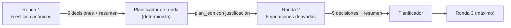

# 08 — Propuesta: iteraciones guiadas por feedback y guardrails

**Fecha:** 2026-11-04, actualizado el 2026-11-12. **Estado:** las partes A (iteraciones) y B (guardrails) están aceptadas desde el 2026-11-12. La parte A está implementada sobre el backend mock (ver «Implementación» al final de la parte A); de la parte B solo lo marcado como *H1*. Registro formal en ADR-007 y ADR-008 ([03 — Decisiones](03_DECISIONES_Y_RIESGOS.md)).

## Por qué

La rúbrica evalúa dos cosas que el diseño actual no cubre:

| Criterio | Texto de la rúbrica | Brecha actual |
|---|---|---|
| Modelo generativo (3 pts) | «Hay correspondencia entre las decisiones del usuario y las iteraciones» | D-10 fija una sola generación por sesión: las decisiones no influyen en nada posterior |
| Explicabilidad (3 pts) | «Coherencia entre las preferencias del usuario y las iteraciones» | El resumen describe decisiones, pero no hay iteraciones que explicar |
| Interacción humano-IA (3 pts) | «…alternativas predefinidas… o instrucciones completamente escritas por el usuario» | Solo hay presets fijos |
| Aspectos éticos (2 pts) | «Implementa guardrails… Durante la demostración…» | Solo hay reflexión; ningún guardrail ejecutable visible en la demo |

---

## Parte A — Iteraciones (ADR-007)

### Propuesta: la ronda siguiente es una sesión hija

Una **ronda** sigue siendo una sesión: una imagen, una máscara, **exactamente cinco variaciones**, cinco decisiones y un resumen. D-10 no cambia. Lo nuevo es que, tras resumir una sesión, la persona puede pedir **otra ronda**, que crea una sesión hija enlazada a la anterior y cuyo plan de cinco variaciones se deriva de las decisiones de la ronda previa.



Opciones descartadas:

- **Regenerar solo las rechazadas dentro de la misma sesión:** rompe «exactamente cinco por lote», mezcla decisiones de dos lotes en una sesión y obliga a rehacer la máquina de estados.
- **Que el LLM escriba los prompts de la ronda siguiente:** convierte texto no confiable (los motivos) en instrucciones para el generador y vuelve inverificable la correspondencia.

### Planificador de ronda (determinista y auditable)

Entrada: las cinco decisiones de la ronda anterior, sus motivos, y una nota de ajuste opcional. Salida: cinco `VariationSpec` y un `plan_json` que dice **por qué** existe cada una.

| Situación en la ronda anterior | Plan de la ronda siguiente |
|---|---|
| `k ≥ 1` aceptadas | Cada estilo aceptado se repite con otra semilla. Los `5 − k` huecos se llenan con **variantes** de los estilos aceptados (modificadores del vocabulario cerrado, ver abajo), repartidos en orden de aceptación. |
| 0 aceptadas | Los cinco estilos se repiten con **variantes alternativas** de prompt y semillas nuevas; los ajustes extraídos de los motivos se aplican a todas. |
| Motivo con un ajuste reconocido (p. ej. «muy oscuro») | Se añade el modificador correspondiente (p. ej. `brighter`) a la variación derivada de ese estilo. |

Ejemplo de `plan_json` para una variación:

```json
{"position": 3, "style": "warm", "variant": "warm+brighter", "seed": 81231,
 "because": [{"round": 1, "variation_position": 3, "decision": "accepted"},
             {"round": 1, "variation_position": 3, "adjustment": "brighter", "source": "reason"}]}
```

`because` permite que el agente explique la ronda siguiente **citando registros**, y que el validador compruebe esas citas igual que hoy comprueba los motivos.

### Vocabulario cerrado de ajustes

Ni los motivos ni la nota de ajuste llegan jamás al prompt como texto libre. Se traducen a una lista cerrada de modificadores, cada uno con un fragmento de prompt fijo y revisado:

`brighter`, `darker`, `less_saturated`, `more_saturated`, `warmer`, `cooler`, `simpler_background`, `more_props`, `fewer_props`, `wood_surface`, `stone_surface`, `fabric_surface`, `outdoor`, `indoor`.

- **Hito 1–2:** extracción por reglas (palabras clave en español).
- **Hito 3:** el agente Gemini propone ajustes en salida estructurada; Python solo acepta valores del vocabulario y que citen un motivo existente.

Esto también cubre «instrucciones escritas por el usuario»: la persona escribe libremente y el sistema le muestra qué ajustes entendió **antes** de generar.

### Cambios de contrato propuestos

| Elemento | Cambio |
|---|---|
| `sessions` | `parent_session_id` (nulo en la ronda 1), `round_index` (1..3), `round_plan_json` |
| Invariante de lote | «5 estilos distintos» pasa a «5 `(style, variant)` distintos»; en la ronda 1 sigue valiendo la regla actual |
| API | `POST /sessions/{id}/next-round` con `{"adjustment_note": str \| null}` → `201` sesión hija en `SEGMENTED` (hereda imagen y máscara). Solo si la madre está `SUMMARIZED`; `409` si ya tiene hija o se alcanzó la ronda máxima |
| Resumen | Por ronda, igual que hoy, más un resumen de la cadena: qué se mantuvo, qué se cambió y por qué, con citas verificables a `plan_json` |
| UI | Botón «Nueva ronda con mis preferencias», campo de nota de ajuste y vista previa de los ajustes entendidos |

### Métricas nuevas

- Tasa de aceptación por ronda (¿sube de la ronda 1 a la 2?).
- Rondas hasta la primera aceptación.
- Exactitud de las citas `because` en el resumen de cadena (objetivo: 100 %).

### Decisiones (2026-11-12)

**Interpretación de «iteraciones».** La rúbrica usa la palabra en tres criterios. En Modelo generativo y en Explicabilidad aparece unida a las decisiones y preferencias del usuario, y el nivel más bajo de Modelo generativo castiga que no haya «coherencia entre lo indicado por el usuario y las imágenes generadas». Se adopta la lectura más exigente: una iteración es una **nueva ronda de cinco imágenes derivada de las decisiones de la ronda anterior**. Las otras lecturas posibles (cada una de las cinco variaciones, o cada ciclo de una sesión) quedan cubiertas por esta, así que no se arriesgan puntos si la docente pensaba en otra.

1. **Máximo de rondas:** 3 por cadena, por costo de GPU y tiempo de demo.
2. **Requisito para la siguiente ronda:** la madre debe estar `SUMMARIZED`, para que cada ronda tenga su resumen verificado antes de derivar la siguiente.
3. **Hitos:** el planificador por reglas y `POST /sessions/{id}/next-round` se adelantaron y ya funcionan sobre el mock, porque no necesitan GPU; con la generación real del Hito 2 solo cambia el backend. La extracción de ajustes con Gemini y el resumen de cadena siguen en el Hito 3.
4. **Docente:** se le informa esta interpretación en la próxima entrega de avance (P9), pero no se espera su respuesta para avanzar.

### Implementación (2026-11-12, sobre mock)

Código en `backend/productshot/services/rounds.py`; pruebas en `tests/test_rounds.py`. Concreta el diseño de arriba así:

- **Orden de aceptación** = hora de la decisión (`decided_at`), con la posición como desempate. Los huecos se reparten en ronda entre los estilos aceptados, y cada hueco suma **un** ajuste nuevo a la variante que hereda.
- **Ronda 3:** la variante aceptada en la ronda 2 se hereda completa (por ejemplo `warm+brighter`) y se le suman los ajustes nuevos.
- **Prioridad entre ajustes:** la nota manda sobre el motivo, y el motivo sobre lo heredado. Dos ajustes contradictorios en la misma fuente (por ejemplo «más oscuro y más luminoso») se descartan los dos y la explicación lo dice.
- **Motivos de variaciones rechazadas** cuando hay alguna aceptada: no cambian el plan, porque su estilo no continúa, pero quedan registrados y la explicación los menciona.
- **Extracción por reglas:** palabras clave en español, sin acentos ni mayúsculas; las frases específicas se evalúan antes («más oscuro» antes que «oscuro»), y una negación cercana («no me gusta la madera», «sin tela») anula los ajustes de gusto (superficies, interior o exterior, más utilería). No entiende ironía ni negaciones lejanas: es la limitación que el Hito 3 cubre con Gemini.
- **Vista previa:** `POST /sessions/{id}/next-round/preview` devuelve el plan con su explicación sin crear la ronda, para mostrar los ajustes entendidos **antes** de generar.
- **Máscara heredada:** la hija apunta a los archivos de la ronda 1 y no puede re-segmentar (409), para que nunca borre archivos de la madre.
- **Explicación:** cada ronda hija agrega a su resumen «Cómo se armó esta ronda», una línea por variación compuesta por Python desde `round_plan_json`, sin texto libre del usuario.
- **Migración:** una base SQLite del Hito 1 original se actualiza sola al arrancar (hoy `PRAGMA user_version` 3, que suma las columnas de G12 y G13).

---

## Parte B — Guardrails (ADR-008)

Este documento es la fuente única de los guardrails; `01_ARQUITECTURA.md` (sección G) solo remite aquí. Capas ordenadas según el flujo. «H1» indica lo que ya está implementado en el Hito 1.

Principio común: ningún fallo deja la sesión en un estado ambiguo ni muestra un resultado parcial como éxito, y cada fallo visible para la persona usuaria trae un mensaje en español con la acción siguiente (reintentar, subir otra foto, subir una máscara o volver más tarde). Cada guardrail registra un evento en los logs para contar cuántas veces se activa durante la evaluación, con el formato `GUARDRAIL <código> code=<motivo> session=<id> ...` en el logger `productshot.guardrails` (implementado para G1, G8, G12, G13 y G14).

| # | Capa | Guardrail | Estado / hito | Qué se ve en la demo |
|---|---|---|---|---|
| G1 | Entrada: imagen | Formato real JPG/PNG (no la extensión), tamaño ≤ 10 MB, límite de píxeles contra *decompression bombs*, corrección de orientación EXIF y original guardado sin metadatos (EXIF, GPS) | **H1** | Subir un archivo no válido muestra un error controlado |
| G2 | Entrada: imagen | Clasificador de contenido inapropiado (NSFW, violencia) sobre la foto subida; se rechaza antes de segmentar | Propuesto, H2 | Foto bloqueada con mensaje explicativo |
| G3 | Entrada: imagen | Detector de rostros: si la foto contiene una cara prominente se rechaza o se pide confirmación, porque el caso de uso es producto y se evita manipular identidad visual de personas | Propuesto, H2 | Foto con persona → aviso |
| G4 | Entrada: texto | Motivos y nota de ajuste: longitud ≤ 500, una sola línea (sin saltos ni caracteres de control, para que no imiten líneas del resumen), se guardan y citan **como dato** y nunca se interpretan; la UI los muestra en texto plano | **H1** (pruebas T11 y de motivo multilínea) | Motivo con «ignora instrucciones…» aparece citado, sin efecto |
| G5 | Entrada: texto | Nota de ajuste → vocabulario cerrado (Parte A); el texto libre nunca llega al prompt | Reglas **H1** (rondas sobre mock); Gemini en H3 | Se muestra «ajustes entendidos» |
| G6 | Generación | Prompts fijos versionados por estilo y *negative prompt* (sin personas, texto, logotipos nuevos, NSFW) | Prompts escritos en H1 (`presets.py`), sin probar | — |
| G7 | Salida: imagen | Clasificador NSFW sobre cada una de las cinco salidas (SDXL no trae *safety checker* propio). Si una falla, se regenera con otra semilla hasta N veces; si no, la sesión queda `FAILED` (se mantiene el «cinco o nada») | Propuesto, H2 | Registro del filtro en los metadatos |
| G8 | Salida: fidelidad | Recomposición de los píxeles del producto desde el original con la máscara, y verificación de que la región protegida no cambió (ΔE / SSIM dentro de la máscara bajo un umbral). Evita alterar logotipos, etiquetas o colores, es decir, publicidad engañosa | **H1** sin modelos: recomposición siempre y métrica `protected_mean_abs_diff` (diferencia media por canal, 0 a 255; ΔE y SSIM cuando haya imágenes reales) | Métrica de fidelidad por variación |
| G9 | Transparencia | Rótulo visible «Imagen generada con IA» opcional al descargar y metadato en el PNG (`Software`, `ai_generated=true`); en el Hito 1 todo resultado mock lleva la franja «SIMULACIÓN» | Rótulo mock **H1**; resto propuesto, H2 | Franja/metadato visible |
| G10 | Agente | Herramientas de solo lectura, salida estructurada validada contra la base de datos, sin inferir motivos no escritos, fallback explícito | Validador **H1**; LLM en H3 | Resumen con `validation_status` |
| G11 | Operación | Límite de rondas por cadena, límite de generaciones por cliente y por hora (429 «Alcanzaste el límite, inténtalo más tarde»), autenticación en GCP, retención limitada y borrado (`DELETE /sessions/{id}`) de fotos | Límite de 3 rondas y borrado **H1**; el resto propuesto, H6 | — |
| G12 | Entrada: imagen | Calidad de la foto: umbrales de brillo y nitidez (varianza del laplaciano). Solo advierte, no bloquea | **H1**: brillo medio y varianza del laplaciano; umbrales provisionales | Aviso «La foto está muy oscura o borrosa» |
| G13 | Segmentación | Heurística sobre la máscara: área protegida fuera de un rango o varios componentes grandes indican que no hay un producto principal. Se ofrece reintentar, subir máscara o continuar | **H1**: fracción protegida fuera de 3 % a 85 % o dos o más objetos de 1 % o más; umbrales provisionales | Aviso antes de generar |
| G14 | Generación | Timeout configurable por lote; al vencer, la sesión pasa a `FAILED` con un mensaje claro (503 si el worker no responde) | **H1**: 600 s por defecto; al consultar una sesión vencida pasa a `FAILED`, y un resultado que llega tarde se descarta | Mensaje «El servicio está ocupado, inténtalo más tarde» |

### Prioridad sugerida (costo/beneficio para la nota)

1. **G8** (fidelidad): es el corazón ético del caso, porque un producto alterado en una foto de venta engaña al comprador, y además produce métricas para el informe.
2. **G7 + G2** (clasificador NSFW en entrada y salida): un solo modelo reutilizado en dos puntos.
3. **G3** (rostros): barato con un detector clásico y argumenta «manipulación de identidad visual», que el enunciado menciona explícitamente.
4. **G5 y G9**: salen casi gratis si se implementa la Parte A.

### Decisiones (2026-11-12)

1. **Foto con rostro (G3):** se rechaza con 422 «Esta herramienta es para fotos de productos, sin personas». Las fotos de personas quedan fuera del nicho (`00_ALCANCE_Y_REQUISITOS.md`).
2. **Clasificador NSFW (G2, G7):** se elige en el Hito 2 comparando licencia, tamaño y VRAM junto a SDXL en la L4; el mismo modelo se usa en entrada y salida.
3. **Umbrales de G8, G12 y G13:** configurables y calibrados con los casos obligatorios del Hito 2; no se fijan antes de medir.
4. **Retención:** en local, `data/` se borra al cerrar el proyecto. Las fotos de la prueba con usuarios se borran al terminar, salvo autorización expresa. En GCP, siete días y borrado manual con `DELETE /sessions/{id}`.
