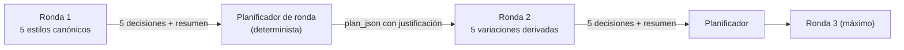

# 08 — Propuesta: iteraciones guiadas por feedback y guardrails

**Fecha:** 2026-11-04. **Estado:** propuesta para revisión del equipo; nada de este documento está implementado salvo lo marcado como *Hito 1*. Registro formal en ADR-007 y ADR-008 ([03 — Decisiones](03_DECISIONES_Y_RIESGOS.md)).

## Por qué

La rúbrica evalúa dos cosas que el diseño actual no cubre:

| Criterio | Texto de la rúbrica | Brecha actual |
|---|---|---|
| Modelo generativo (3 pts) | «Hay correspondencia entre las decisiones del usuario y las iteraciones» | D-10 fija una sola generación por sesión: las decisiones no influyen en nada posterior |
| Explicabilidad (3 pts) | «Coherencia entre las preferencias del usuario y las iteraciones» | El resumen describe decisiones, pero no hay iteraciones que explicar |
| Interacción humano-IA (3 pts) | «…alternativas predefinidas… o instrucciones completamente escritas por el usuario» | Solo hay presets fijos |
| Aspectos éticos (2 pts) | «Implementa guardrails… Durante la demostración…» | Solo hay reflexión; ningún guardrail ejecutable visible en la demo |

---

## Parte A — Iteraciones (ADR-007)

### Propuesta: la ronda siguiente es una sesión hija

Una **ronda** sigue siendo una sesión: una imagen, una máscara, **exactamente cinco variaciones**, cinco decisiones y un resumen. D-10 no cambia. Lo nuevo es que, tras resumir una sesión, la persona puede pedir **otra ronda**, que crea una sesión hija enlazada a la anterior y cuyo plan de cinco variaciones se deriva de las decisiones de la ronda previa.



Opciones descartadas:

- **Regenerar solo las rechazadas dentro de la misma sesión:** rompe «exactamente cinco por lote», mezcla decisiones de dos lotes en una sesión y obliga a rehacer la máquina de estados.
- **Que el LLM escriba los prompts de la ronda siguiente:** convierte texto no confiable (los motivos) en instrucciones para el generador y vuelve inverificable la correspondencia.

### Planificador de ronda (determinista y auditable)

Entrada: las cinco decisiones de la ronda anterior, sus motivos, y una nota de ajuste opcional. Salida: cinco `VariationSpec` y un `plan_json` que dice **por qué** existe cada una.

| Situación en la ronda anterior | Plan de la ronda siguiente |
|---|---|
| `k ≥ 1` aceptadas | Cada estilo aceptado se repite con otra semilla. Los `5 − k` huecos se llenan con **variantes** de los estilos aceptados (modificadores del vocabulario cerrado, ver abajo), repartidos en orden de aceptación. |
| 0 aceptadas | Los cinco estilos se repiten con **variantes alternativas** de prompt y semillas nuevas; los ajustes extraídos de los motivos se aplican a todas. |
| Motivo con un ajuste reconocido (p. ej. «muy oscuro») | Se añade el modificador correspondiente (p. ej. `brighter`) a la variación derivada de ese estilo. |

Ejemplo de `plan_json` para una variación:

```json
{"position": 3, "style": "warm", "variant": "warm+brighter", "seed": 81231,
 "because": [{"round": 1, "variation_position": 3, "decision": "accepted"},
             {"round": 1, "variation_position": 3, "adjustment": "brighter", "source": "reason"}]}
```

`because` permite que el agente explique la ronda siguiente **citando registros**, y que el validador compruebe esas citas igual que hoy comprueba los motivos.

### Vocabulario cerrado de ajustes

Ni los motivos ni la nota de ajuste llegan jamás al prompt como texto libre. Se traducen a una lista cerrada de modificadores, cada uno con un fragmento de prompt fijo y revisado:

`brighter`, `darker`, `less_saturated`, `more_saturated`, `warmer`, `cooler`, `simpler_background`, `more_props`, `fewer_props`, `wood_surface`, `stone_surface`, `fabric_surface`, `outdoor`, `indoor`.

- **Hito 1–2:** extracción por reglas (palabras clave en español).
- **Hito 3:** el agente Gemini propone ajustes en salida estructurada; Python solo acepta valores del vocabulario y que citen un motivo existente.

Esto también cubre «instrucciones escritas por el usuario»: la persona escribe libremente y el sistema le muestra qué ajustes entendió **antes** de generar.

### Cambios de contrato propuestos

| Elemento | Cambio |
|---|---|
| `sessions` | `parent_session_id` (nulo en la ronda 1), `round_index` (1..3), `round_plan_json` |
| Invariante de lote | «5 estilos distintos» pasa a «5 `(style, variant)` distintos»; en la ronda 1 sigue valiendo la regla actual |
| API | `POST /sessions/{id}/next-round` con `{"adjustment_note": str \| null}` → `201` sesión hija en `SEGMENTED` (hereda imagen y máscara). Solo si la madre está `SUMMARIZED`; `409` si ya tiene hija o se alcanzó la ronda máxima |
| Resumen | Por ronda, igual que hoy, más un resumen de la cadena: qué se mantuvo, qué se cambió y por qué, con citas verificables a `plan_json` |
| UI | Botón «Nueva ronda con mis preferencias», campo de nota de ajuste y vista previa de los ajustes entendidos |

### Métricas nuevas

- Tasa de aceptación por ronda (¿sube de la ronda 1 a la 2?).
- Rondas hasta la primera aceptación.
- Exactitud de las citas `because` en el resumen de cadena (objetivo: 100 %).

### Preguntas para el equipo

1. ¿Máximo de 3 rondas por cadena (costo de GPU)?
2. ¿Se exige `SUMMARIZED` antes de la ronda siguiente, o basta `REVIEWED`?
3. ¿Hito: 2 (con generación real) o 3 (cuando el agente ya extrae ajustes)? Propuesta: el planificador por reglas en el Hito 2 y la extracción con Gemini en el Hito 3.
4. ¿Confirmar con la docente que «iteración» se entiende así (rondas de cinco, no regeneración individual)?

---

## Parte B — Guardrails (ADR-008)

Capas ordenadas según el flujo. «H1» indica lo que ya está implementado en el Hito 1.

| # | Capa | Guardrail | Estado / hito | Qué se ve en la demo |
|---|---|---|---|---|
| G1 | Entrada: imagen | Formato real JPG/PNG (no la extensión), tamaño ≤ 10 MB, límite de píxeles contra *decompression bombs*, corrección de orientación EXIF | **H1** | Subir un archivo no válido muestra un error controlado |
| G2 | Entrada: imagen | Clasificador de contenido inapropiado (NSFW, violencia) sobre la foto subida; se rechaza antes de segmentar | Propuesto, H2 | Foto bloqueada con mensaje explicativo |
| G3 | Entrada: imagen | Detector de rostros: si la foto contiene una cara prominente se rechaza o se pide confirmación, porque el caso de uso es producto y se evita manipular identidad visual de personas | Propuesto, H2 | Foto con persona → aviso |
| G4 | Entrada: texto | Motivos y nota de ajuste: longitud ≤ 500, se guardan y citan **como dato** y nunca se interpretan; la UI los muestra en texto plano | **H1** (prueba T11) | Motivo con «ignora instrucciones…» aparece citado, sin efecto |
| G5 | Entrada: texto | Nota de ajuste → vocabulario cerrado (Parte A); el texto libre nunca llega al prompt | Propuesto, H2/H3 | Se muestra «ajustes entendidos» |
| G6 | Generación | Prompts fijos versionados por estilo y *negative prompt* (sin personas, texto, logotipos nuevos, NSFW) | Prompts escritos en H1 (`presets.py`), sin probar | — |
| G7 | Salida: imagen | Clasificador NSFW sobre cada una de las cinco salidas (SDXL no trae *safety checker* propio). Si una falla, se regenera con otra semilla hasta N veces; si no, la sesión queda `FAILED` (se mantiene el «cinco o nada») | Propuesto, H2 | Registro del filtro en los metadatos |
| G8 | Salida: fidelidad | Recomposición de los píxeles del producto desde el original con la máscara, y verificación de que la región protegida no cambió (ΔE / SSIM dentro de la máscara bajo un umbral). Evita alterar logotipos, etiquetas o colores, es decir, publicidad engañosa | Propuesto, H2 | Métrica de fidelidad por variación |
| G9 | Transparencia | Rótulo visible «Imagen generada con IA» opcional al descargar y metadato en el PNG (`Software`, `ai_generated=true`); en el Hito 1 todo resultado mock lleva la franja «SIMULACIÓN» | Rótulo mock **H1**; resto propuesto, H2 | Franja/metadato visible |
| G10 | Agente | Herramientas de solo lectura, salida estructurada validada contra la base de datos, sin inferir motivos no escritos, fallback explícito | Validador **H1**; LLM en H3 | Resumen con `validation_status` |
| G11 | Operación | Límite de rondas por cadena, límite de solicitudes por cliente, autenticación en GCP, retención limitada y borrado (`DELETE /sessions/{id}`) de fotos | Propuesto, H6 (borrado: H2) | — |

### Prioridad sugerida (costo/beneficio para la nota)

1. **G8** (fidelidad): es el corazón ético del caso, porque un producto alterado en una foto de venta engaña al comprador, y además produce métricas para el informe.
2. **G7 + G2** (clasificador NSFW en entrada y salida): un solo modelo reutilizado en dos puntos.
3. **G3** (rostros): barato con un detector clásico y argumenta «manipulación de identidad visual», que el enunciado menciona explícitamente.
4. **G5 y G9**: salen casi gratis si se implementa la Parte A.

### Preguntas para el equipo

1. ¿Rechazar o solo advertir ante una foto con rostro?
2. ¿Qué clasificador NSFW (licencia, tamaño, si cabe junto a SDXL en la L4)? Hay que medirlo en el Hito 2.
3. ¿Umbral de fidelidad de G8? Hay que calibrarlo con los casos obligatorios (taza con logotipo, texto pequeño).
4. ¿Política de retención: cuántos días se guardan las fotos?
